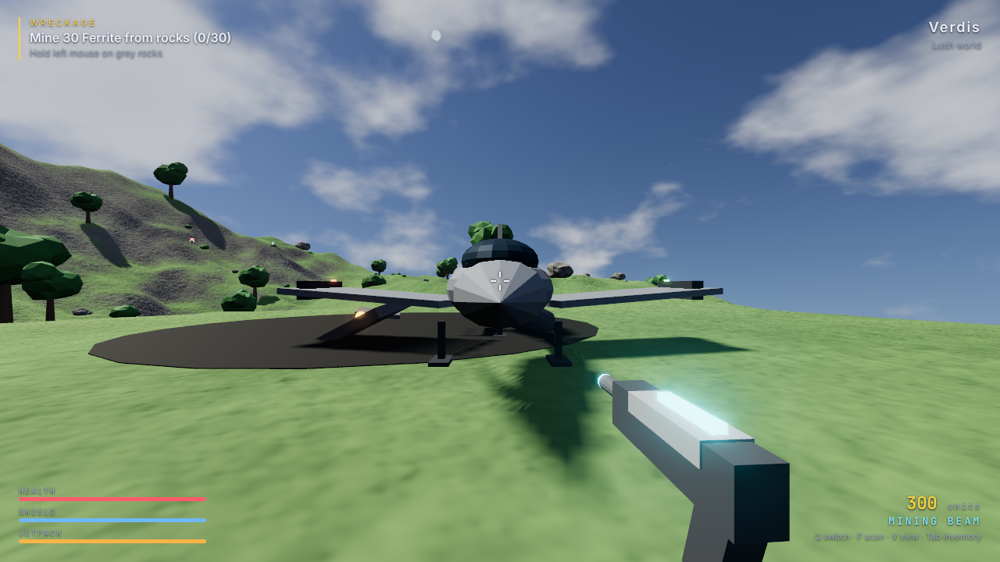
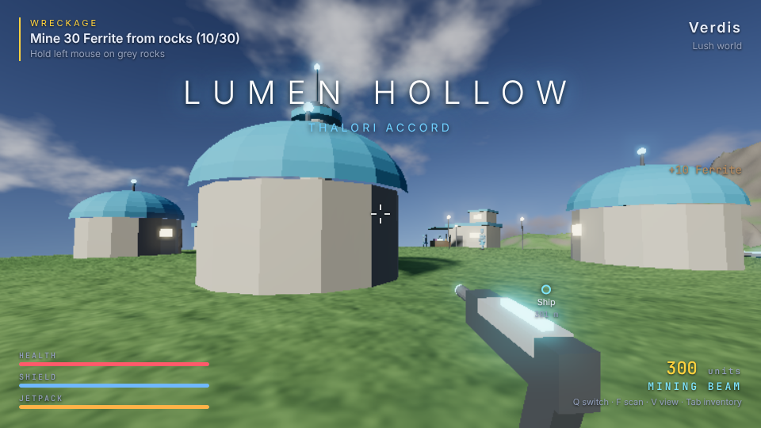
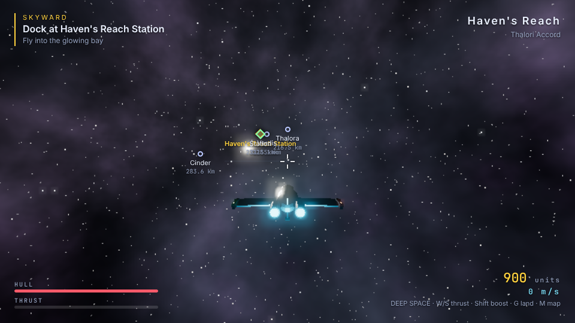
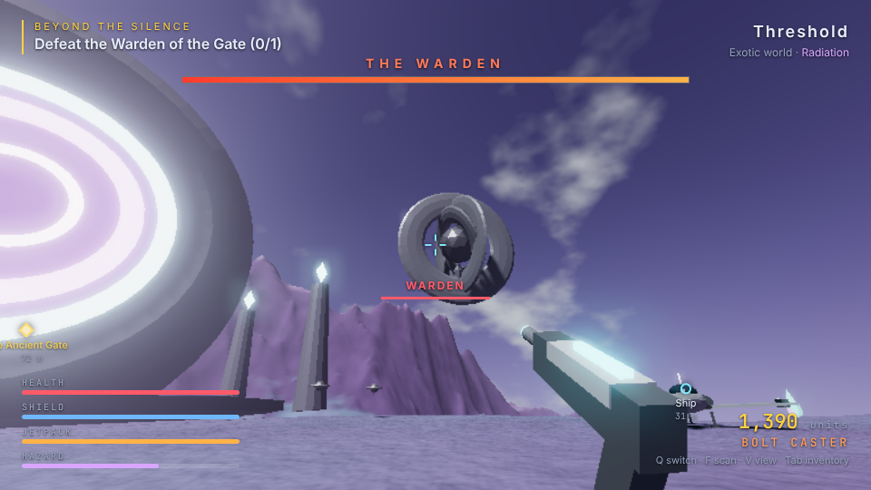

# SPACE MINER: Beyond the Silence

A 3D space exploration game that runs in the browser. You crash on an alien
world, mine it on foot, repair your ship, fly it off the planet into space with
no loading screen, and travel an endless galaxy of kingdoms, traders, raiders
and ruins to open the Ancient Gate.






## Play

```
npm start          # then open http://localhost:5173
```

No install and no build step: plain ES modules, with Three.js vendored in
`vendor/`. Any static file server works. A desktop browser with WebGL 2, a
mouse and a keyboard are required.

## Controls

| | |
|---|---|
| WASD / mouse | move / look |
| Space | jump, hold for jetpack |
| Shift | run, ship boost |
| Left mouse | mine or fire |
| Q | switch mining beam / bolt caster |
| F | scanner |
| E | interact, talk, board ship |
| V | first / third person |
| H | med gel |
| Tab, J, M | inventory and crafting, journal, galaxy map |
| G | auto-land the ship |
| A D, X | roll ship, cut throttle |
| Esc | pause and settings |

## What is in the game

- **Planets you can walk on.** Whole spherical worlds with eight biomes, seas
  and lava, weather hazards, day and night, trees, rocks and ore to mine.
- **Seamless space flight.** Take off, leave the atmosphere, dock at a station,
  fight pirates, and warp between star systems from the galaxy map.
- **An endless galaxy.** Every system and planet is generated from its
  coordinates, so the map never ends and is the same every time you return.
- **Three alien kingdoms** (Thalori, Grumm, Vesh) with villages, capitals,
  market prices that reward trade routes, reputation and contracts.
- **Combat** against raiders, sentinels, pirates and a boss.
- **A six-chapter story** with two endings, then free play.
- **Upgrades and cosmetics**: tools, jetpack, shield, cargo, ship hull and
  cannon; suit, visor, ship and engine-trail colours.
- Autosave to the browser, four graphics presets, synthesized sound and music.

## Graphics: what it is and is not

Real-time WebGL 2 rendering: HDR with ACES tone mapping and bloom, soft shadow
maps, a ray-marched atmospheric scattering sky, animated water, cloud layers,
and level-of-detail terrain from orbit to ground. Models are procedural and
low-poly by design.

It does **not** use hardware ray tracing (browsers do not expose it), and it is
not at the fidelity of a large studio title. Physics is purpose-built (spherical
gravity, jetpack, swimming, arcade flight), not a general rigid-body engine.

## Tests

```
npm test             # universe generation, economy, story, saving
npm run test:classic # tests for the earlier 2D game
```

The full story was also played start to finish in a headless browser. That
environment renders in software, so frame rate on real graphics hardware and the
audio were not measured there. Touch devices are not supported.

## Layout

```
src/core       noise and random numbers
src/universe   galaxy, planets, biomes, items, factions
src/world      terrain, shaders, models, settlements, props
src/engine     renderer and post-processing
src/game       player, ship, actors, story, state and saving
src/ui         HUD, menus, audio
classic/       the earlier 2D version of the game, kept playable
```

Three.js is MIT licensed; see `vendor/THREE-LICENSE`.
