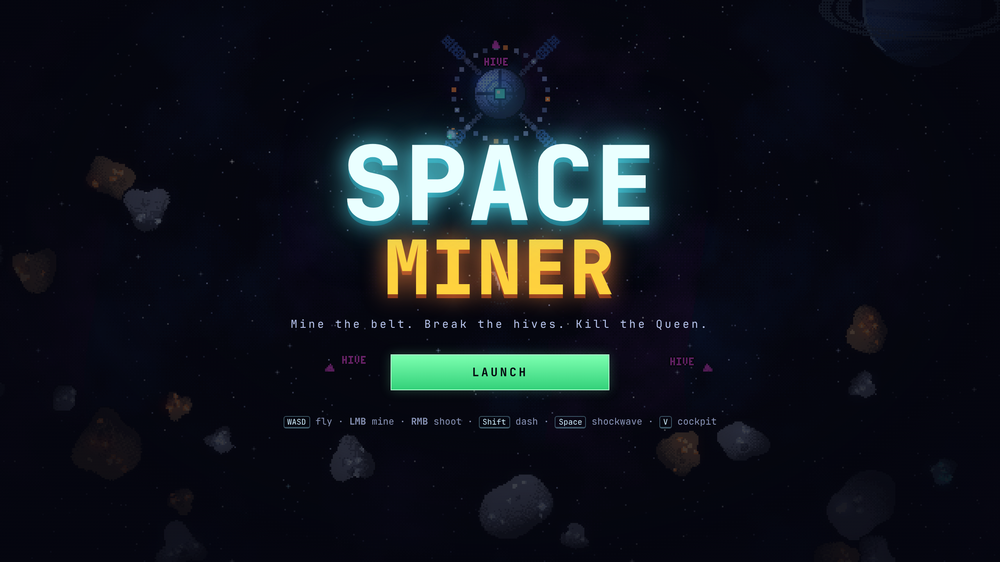
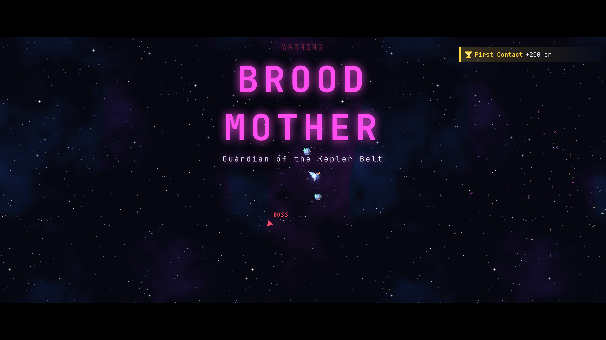
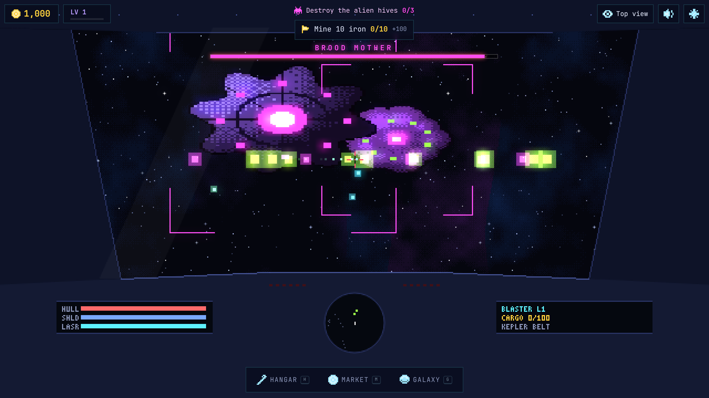

# SPACE MINER

*Mine the belt. Break the hives. Kill the Queen.* A pixel-art space action
game for short breaks. Plain ES modules, no build step, no dependencies.






```bash
npm start        # then open http://localhost:5173/
npm test         # headless simulation tests
```

## The game

You start as a lone miner in the Kepler Belt. Mine ore, sell it, upgrade.
But every sector is infested: destroy its three **alien hives** and the
**sector boss** comes for you. Beat it to open the next sector. Four sectors,
four bosses, ending with the **Hive Queen**.

| Control | Action |
| --- | --- |
| `W A S D` | Fly |
| `Shift` | **Dash** (brief invulnerability); hold to boost |
| Mouse + **left click** | Mining laser |
| **Right click** / `F` | Fire weapon |
| `1`–`4` / `Q` | Switch weapon |
| `Space` | Shockwave |
| `E` | Dock (sells cargo, free repair) / salvage |
| `V` | Cockpit view (`W`/`S` thrust, `A`/`D` turn, click for mouselook) |
| `H` `M` `G` | Hangar, Market, Galaxy |
| `P` / `Esc` | Pause |

## What's in it

- **Campaign**: hives → boss → next sector. Bosses (Brood Mother, Storm
  Reaper, Ember Titan, Hive Queen) cycle bullet patterns (rings, spirals,
  aimed bursts, crosses), summon minions and enrage at half health.
- **Perks**: every level-up, pick 1 of 3 from 14 stackable perks: Twin
  Barrels, Ricochet, Critical Hits, Volatile Kills, Wingmen, Chain Laser,
  Salvage Nanites and more.
- **Enemies**: swarmers, spitters, bombers, brutes, snipers (telegraphed
  lance), shielded guardians, pirates, gold **elites** that drop power-ups.
- **Power-ups**: Overdrive, Quad Damage, Barrier, Magnet, Repair, Nuke.
- **Weapons**: Blaster, Scatter, homing Missiles, piercing Railgun, each
  upgradable. Six ship upgrades, four hulls, mining drones that work offline.
- **Feel**: adaptive music (calm → combat → boss), glow, hit-stop, slow
  motion on boss kills, damage numbers, kill-streak callouts, boss intros.
- Title screen, pause, autosave, synthesized audio, phone support.

## Code layout

```
src/
  main.js               loop, hit-stop / slow-mo, autosave, offline progress
  core/                 config (all content + balance), state, math
  engine/               GameEngine (fixed-order step), GameLoop, input, camera
  systems/              pure simulation, no DOM: Player, Mining, Combat,
                        Campaign, Asteroids, Resources, Drones, Economy,
                        Upgrades (+ perks), Missions, Achievements, Events, Save
  render/               Renderer (top view), CockpitRenderer (first person),
                        procedural sprites, backdrop, particles
  ui/                   UIManager (HUD, screens, title, perks), audio + music
tests/                  node:test suite and a bot that plays the game
```
