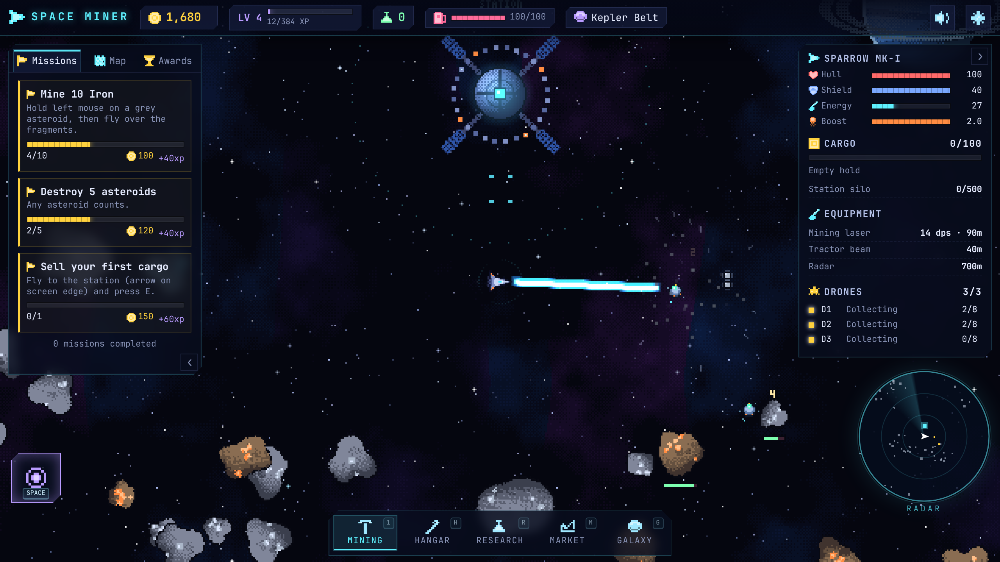

# SPACE MINER

*Explore. Mine. Upgrade. Expand.* A pixel-art space mining game for the gaps
between AI code generations. Plain ES modules, no build step, no
dependencies, a headless-testable simulation.



```bash
npm start        # then open http://localhost:5173/
```

### How it plays

Fly into the asteroid field, burn rocks with your mining laser, fly over the
fragments to scoop them into your hold, then dock at the station and sell.
Spend credits on upgrades, buy drones that mine on their own (even while you
are away), research new tech and warp to richer, more dangerous fields.

| Control | Action |
| --- | --- |
| `W A S D` / arrows | Fly (inertia, uses fuel) |
| Mouse | Aim |
| Hold left click | Mining laser (uses energy, can overheat) |
| `Shift` | Boost |
| `E` | Dock at the station / salvage a derelict / undock |
| `Space` | Pulse Blast: damages nearby rock, repels pirates, pulls fragments |
| `H` `R` `M` `G` (or `1`–`5`) | Hangar, Research, Market, Galaxy, back to Mining |
| `Tab` / `Esc` | Hide side panels / close screen |

On touch screens the ship flies toward your finger and fires at the nearest rock.

What's in V1:

- **Five ores** (Iron 5, Copper 8, Silicon 12, Nickel 18, Rare Crystal 50 cr)
  in three asteroid sizes. Better ore sits further from the station.
- **Market** with drifting prices (sparklines), big sales nudge prices down.
  Your hold sells only while docked; the drone silo sells from anywhere.
  Refuel and repair at the station.
- **Hangar**: 17 upgrade lines across laser, engine, cargo, scanner, shield
  and fuel tank, each with a visible real effect; 5 fleet-wide drone upgrades;
  4 ship hulls.
- **Drones** find rock, mine it, vacuum fragments and haul them to the station
  silo, or escort you and unload into your hold (after research).
- **Research** tree paid in research points from levels, exploration,
  missions, salvage and achievements.
- **Galaxy**: four asteroid fields unlocked by level, credits and research.
- **Missions** (a scripted first run, then generated), **achievements**, and
  **random events**: meteor showers, rare motherlodes, solar storms, pirate
  raids, derelicts to salvage and energy anomalies.
- **Saving**: automatic to `localStorage` every few seconds, after every
  important action and when the page closes. Drones keep mining while you are
  away (capped at 2h, 6h with research), credited when you come back.
- Synthesized sound effects and ambient music (Web Audio), with mute and volume.

### Architecture

```
index.html, styles.css
  src/
    main.js                  bootstraps everything, autosave, offline progress
    core/   config.js        all balance numbers and content
            state.js         the centralized game state + derived stats
            math.js
    engine/ GameEngine.js    fixed-order simulation step and player actions
            GameLoop.js      rAF driver with a fixed 60 Hz step
            InputController.js, CameraController.js
    systems/                 pure simulation, no DOM
            PlayerController, AsteroidManager, MiningSystem, ResourceManager,
            DroneManager, EconomyManager, UpgradeManager, MissionManager,
            AchievementManager, EventManager, ExplorationSystem, SaveManager
    render/                  Canvas 2D at low resolution, scaled up pixelated
            Renderer.js, sprites.js (procedural pixel art), background.js,
            particles.js (pooled), pixelfont.js
    ui/     UIManager.js (DOM HUD + screens), AudioManager.js, radar.js, icons.js
```

The simulation only mutates state and emits effect events; the renderer, UI
and audio consume those events. That keeps rendering separate from logic and
lets `tests/space.test.js` play the whole game headless in Node: the
acceptance loop (mine, collect, dock, sell, upgrade, deploy drones, missions,
save and reload), economy rules, events, offline progress, save validation
and a bot that checks first-five-minutes pacing.
